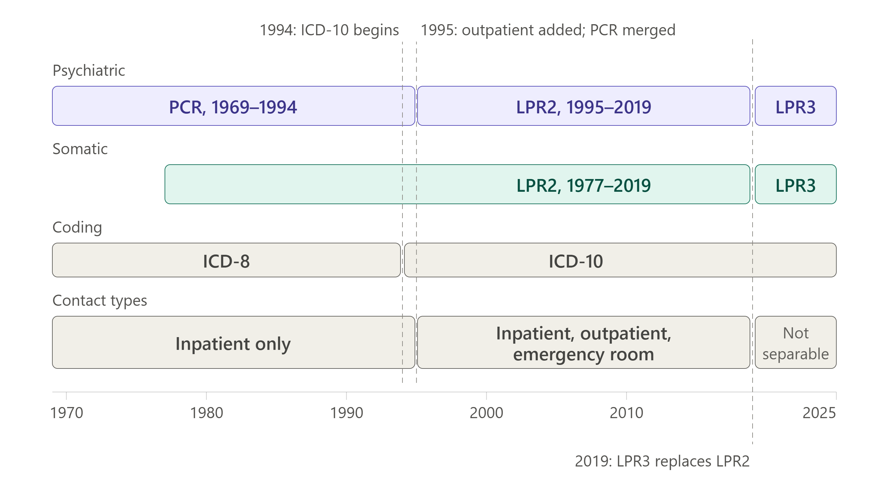

Overview of registers from Statistics Denmark (DST) and the The Danish
Health Data Authority (SDS)
================

<!-- The .md file is generated from an .Rmd file. Please edit the .Rmd; not the .md !! -->

------------------------------------------------------------------------

> - **Version**: 2.0
> - **Authors**: Clara S. Grønkjær, Rune H. B. Christensen, Eva N. S.
>   Wandall
> - **Reviewers**: NA
> - **Approved by**: NA
> - **Last edits**: 2026-10-09
> - **Responsible**: NA
> - **Source document**:
>   [DST-and-SDS-register-overview.Rmd](pre-processing/DST-and-SDS-register-overview.Rmd)

------------------------------------------------------------------------

# Table of Contents

1.  [Study Population](#study-population)
2.  [Income](#income)
3.  [Education](#education)
4.  [Employment Status](#employment-status)
5.  [Hospital Contacts](#hospital-contacts)
6.  [Psychiatric Diagnoses](#psychiatric-diagnoses)
7.  [Parental Psychiatric Disorder](#parental-psychiatric-disorder)
8.  [Charlson Comorbidity Index
    (CCI)](#charlson-comorbidity-index-(cci))
9.  [Medication](#medication)
10. [Laboratory Results](#laboratory-results)

# Overview

This document is intended for researchers initiating a register-based
study using data from:

- Statistics Denmark (Danish: *Danmarks Statistik*, *DST*), and
- The Danish Health Data Authority (Danish: *Sundhedsdatastyrelsen*,
  *SDS*).

📄 **The document describes:**

- The definition of the study population.
- Implemented variables derived from national registers.
- Known methodological issues.
- Points requiring analytical decisions.

We use the following icons:

💻 **Location of program on the DST server**

⚠ **Possible methodological problems**

✔ **Possible solutions**

🕮 **Resources**

## General Resources

🕮 **Resources**

- Statistics Denmark (DST):
  - [**Variable
    definitions**](https://www.dst.dk/extranet/forskningvariabellister/Oversigt%20over%20registre.html)
- The Danish Health Data Authority (SDS):
  - [**Register documentation**](https://www.esundhed.dk/Dokumentation)
  - [**Definitions of words and
    terms**](https://www.esundhed.dk/Dokumentation/Dokumentation-af-ord-og-begreber#)
  - [**Codes and
    mappings**](https://www.esundhed.dk/Emner/Aktuelt/Kodeark-mm)

[Back to top](#overview)

# Study Population

💻 **Location of program on the DST server**: The population is defined
in the program `10_make_population.rmd` located in:

<pre>
└── E:
    └── ProjektDB
        └── PSYK
            └── Workdata
                └── 708237
                    └── data_derived_YYYY
                        └── reports
                            ├── 10_make_population.rmd
                            └── 10_make_population.html
</pre>

Where `YYYY` is a year.

All data are updated at most once a year. When they are, `YYYY` is
updated to reflect the year of the new data content.

## Used Registers

To define the study population, some of the used registers are:

- The Population Statistics Register (Danish: *Befolkningsregister*,
  *BEF*).
- The Danish Civil Registration System (Danish: *Det Centrale
  Personregister*, *CPR*).
- The Danish Medical Birth Register (Danish: *Det Medicinske
  Fødselsregister*, *MFR*).

## Linkage of Individuals Across Registers

**Individuals are linked** across registers using the individual
identifier Civil Registration Number (*CPR*). In the registers, this
variable is often named `pnr`, but in SDS data often `cpr` or
`cprnummer`. It is an encrypted version of the CPR-number.

### Subject id

A person’s CPR number can change over time, for example after a legal
gender change, so one person may have two or more `pnr` values. We
therefore generate a subject identifier, `id`, which is unique per
person and corresponds to their currently active `pnr`.

💻 **Location of program on the DST server**:

- The subject id is defined in the program `01_get_subject_id.rmd`.
- The subject id can be merged to a table using the function `pnr2id()`
  located in:

<pre>
└── E:
    └── ProjektDB
        └── PSYK
            └── Workdata
                └── 708237
                    └── RHBC
                        └── 001_functions
                            └── register_functions.R
</pre>

### Linkage of parents and children

👩‍👩‍👧 **Linkage of parents and children** is available through several
registers and variables, and we prioritize them as specified in **Table
1**.

| Priority | Register | Mom                  | Dad                 | Family       |
|----------|----------|----------------------|---------------------|--------------|
| 1        | CPR      | `v_mor_pnr`          | `v_far_pnr`         | .            |
| 2        | MFR      | `m_cpr`, `cpr_moder` | `fcpr`, `cpr_fader` | .            |
| 3        | BEF      | `mor_id`             | `far_id`            | `FAMILIE_ID` |

**Table**: List of priority for linking parents and children. Most
commonly the mom or dad id is used, but for some purposes, the family ID
[`FAMILIE_ID`](https://www.dst.dk/da/TilSalg/data-til-forskning/generelt-om-data/dokumentation-af-data/hoejkvalitetsvariable/familier/familie-id)
from BEF is also used.

💻 **Location of program on the DST server**: The parental link is
defined in the program `11_get_parenta_link.rmd`.

## Valid Observations

To define the valid observations, we create an indicator variable,
`i_valid`, which is $1$ if the individual

- Has a valid CPR-number (`i_cprstart == 1`), and
- Is in Denmark (`f_dkstatus != "exit"`), and
- Is alive (`is_dead == 0`), and
- The CRP-number is not censored (`f_cprsens  == "00"`).

Otherwise, the observation is not valid, and the variable `i_valid = 0`.

### Variable Definitions

- `i_cprstart` — The individual has a valid CPR-number start (Danish:
  *CPR-start*).
- `f_dkstatus` — Residency status (Danish: *Bopælsstatus*).
- `is_dead` — Mortality indicator.
- `f_cprsens` — CPR sensitivity flag (Danish: *CPR-følsomhed*).

⚠ **Possible Problems**

1.  Definitions of residency exit (“*exit*”) may differ across cohorts.
2.  CPR sensitivity (`f_cprsens`) exclusions may bias specific
    sub-populations.
3.  Mortality timing relative to observation window may introduce
    misclassification.

✔ **Possible Solutions**

1.  Explicitly define residency eligibility criteria per study.
2.  Perform sensitivity analyses with and without CPR-sensitive
    individuals.
3.  Ensure time-aligned mortality filtering.

🕮 **Resources**

- [Documentation of CPR from SDS \[in
  Danish\]](https://sundhedsdatastyrelsen.dk/data-og-registre/nationale-sundhedsregistre/cpr-registeret).
- [Variable definitions in BEF from Statistics Denmark \[in
  Danish\]](https://www.dst.dk/extranet/ForskningVariabellister/BEF%20-%20Befolkningen.html).
- [Variable definitions in MFR from Statistics Denmark \[in
  Danish\]](https://www.dst.dk/extranet/ForskningVariabellister/MFR%20-%20Levendef%C3%B8dte%20fra%20det%20medicinske%20f%C3%B8dselsregister.html).

[Back to top](#overview)

# Income

💰 **Individual income** is derived from:

- The Income Statistics Register (Danish: *Indkomstregister*, *IND*).

🏠 **Household, or family, income** (Danish: *Husstandsindkomst*) is
derived from:

- The Register of Family Income (Danish: *Registret for
  Familieindkomster*, *FAIK*)

For information about familial linkage, see the Section [Linkage of
Individuals Across Registers](#linkage-of-individuals-across-registers).

💻 **Location of program on the DST server**: The income data is cleaned
in the program `12_get_income.rmd`.

## Grouping Income

**Income percentiles** are calculated for each individual and year,
based on their annual income relative to the population’s income
distribution in that same year.

**Income quintiles** are then assigned from these percentiles, so a
person’s quintile reflects their income relative to others that year,
not a fixed threshold:

- Q1: 0–20%
- Q2: 20–40%
- Q3: 40–60%
- Q4: 60–80%
- Q5: 80–100%

⚠ **Possible Problems**

1.  **Population-level income quintiles**:

    1.  Quintiles are defined at a general population level and may not
        represent true quintiles within specific study populations.
    2.  Exclusion of specific population subgroups (e.g., individuals
        with psychiatric history) in analyses can distort the
        distribution of the analysed income variable.

2.  **Children and adolescents**:

    1.  Children and adolescents are **not excluded** from the personal
        income quintiles, and therefore they constitute a substantial
        proportion of the lowest quintile.
    2.  Using personal income for children and adolescents (and young
        adults) is not necessarily meaningful in analyses, if the aim is
        to adjust for socioeconomics, since younger individuals do not
        yet have an income of their own.

3.  [ ] **Missing values**:

    1.  Allocation of missing values to the lowest quintile (0–20%) may
        introduce bias. (MUST BE VERIFIED).

4.  **Categorical income**:

    1.  Using categorical variables might lead to residual confounding.

✔ **Possible Solutions**

1.  **Study-population income quintiles**:

    1.  Define quintiles **within each study population**.
    2.  [ ] Develop a standardized quintile-generation function for
        internal use.

2.  **Children and adolescents**:

    1.  As in 1.1, one should define the quintiles within each study
        population.
    2.  If wanting to analyse children and adolsecents, one should
        consider using household income instead.

3.  [ ] **Missing values**:

    1.  Verify, if missing values are assigned to (imputed with) the
        lowest income quintile category.

4.  **Categorical income**:

    1.  Use continuous income ranking (e.g., percentile position such as
        `0.13` for the 13th percentile) instead of quintiles. The
        continuous variable can be adjusted for either linearly or using
        e.g., splines.

🕮 **Resources**

- [Documentation from Statistics Denmark \[in
  Danish\]](https://www.dst.dk/da/Statistik/dokumentation/statistikdokumentation/indkomststatistik).
- [Variable definitions in IND from Statistics Denmark \[in
  Danish\]](https://www.dst.dk/extranet/ForskningVariabellister/IND%20-%20Indkomst.html).
- [Variable definitions in FAIK from Statistics Denmark \[in
  Danish\]](https://www.dst.dk/extranet/ForskningVariabellister/FAIK%20-%20Familieindkomster.html).
- [Baadsgaard and Quitzau (2011): Danish registers on personal income
  and transfer
  payments](https://journals.sagepub.com/doi/10.1177/1403494811405098).
- [Ejlskov and Plana-Ripoll (2025): Income in epidemiological research:
  a guide to measurement and analytical treatment with a case study on
  mental disorders and
  mortality](https://pure.au.dk/portal/da/publications/income-in-epidemiological-research-a-guide-to-measurement-and-ana/).

[Back to top](#overview)

# Education

🎓 **The highest education attained** is derived from:

- The Highest Education Attained Register (Danish:
  *Uddannelsesregister*, *UDDF*).

💻 **Location of program on the DST server**: The education data is
cleaned in the program `14_get_education_level.rmd`.

## Grouping Education

**Education is grouped** based on the variable [`hfaudd` \[in
Danish\]](https://www.dst.dk/da/TilSalg/data-til-forskning/generelt-om-data/dokumentation-af-data/hoejkvalitetsvariable/hoejst-fuldfoerte-uddannelse/hfaudd):

| Group | `hfaudd` value | Mapping Description |
|----|----|----|
| No education | — | No registered education |
| Primary school | — | Primary education |
| Vocational training | — | Vocational education (Danish: *erhvervsuddannelse*) |
| Gymnasium | — | Upper secondary school |
| Higher education (short cycle) | — | Short tertiary education |
| Higher education (long cycle) | — | Long tertiary education |

**Table 2**: The categorization of education is based on the variable
`hfaudd`. *Vocational training* and *Gymnasium* can optionally be
grouped together.

☐ **Why are the `hfaudd` values blank in the table?**

**A mapping of `hfaudd`** is located in:

<pre>
└── E:
    └── ProjektDB
        └── PSYK
            └── Workdata
                └── 708237
                    └── data_derived_YYYY
                        └── 03_keys
                            ├── N_AUUD_HOVED_E_L5L5_KT.txt
                            └── N_AUDD_HOVED_L1L5_KT.txt.
</pre>

☐ **Why are the codes not identical to those in?:**

<pre>
└── E:
    └── Formater
        └── SAS formater i Danmarks Statistik
            └── TXT_filer
                └── Uddannelser
                    ├── N_AUDD2015_L5L5_KT.txt
                    └── N_AUDD2015_L1L5_KT.txt
</pre>

## Self-Reported Values and Imputation

Information on education is obtained from various sources of different
quality, ranging from official student registers to self-reported data.
Imputations are carried out in case of missing data.

- [**A population and housing
  census**](https://www.dst.dk/Site/Dst/SingleFiles/GetArchiveFile.aspx?fi=3780817712238&fo=0&ext=kvaldel)
  (official count) was carried out in 1970, obtaining **self-reported**
  education information.

- [**Immigrants’** \[in
  Danish\]](https://www.dst.dk/Site/Dst/SingleFiles/GetArchiveFile.aspx?fi=formid&fo=medbragt-udd--pdf&ext=%7B2%7D)
  education level is either:

  - **Self-reported** ($\sim 45\%$ overall), and if this is missing,
    then
  - **Imputed** ($\sim 55\%$ overall).

  Later, the information is replaced upon:

  - Completion of an education at a Danish educational institution, or
  - Obention of educational information in relation to authorization.

  Note, survey coverage and response rates varied substantially across
  immigration cohorts, with no survey conducted on an ongoing basis for
  2007–2016 arrivals (partially covered retroactively by the 2005–2016
  wave).

**The source of information** is identified using the variable
[`hf_kilde` \[in
Danish\]](https://www.dst.dk/da/TilSalg/data-til-forskning/generelt-om-data/dokumentation-af-data/hoejkvalitetsvariable/hoejst-fuldfoerte-uddannelse/hf-kilde).

| `hf_kilde` (year of survey or imputation) | Immigrants | Other |
|----|----|----|
| Self-reported | 3 (1999–2006), 17 (2016–) | 2 (1970)\* |
| Imputed | 9 (–2006), 10 (2008), 18 (2007–)\*\* | 7 (discontinued), 16 (discontinued) |

**Table 3**: The source of each education record can be identified via
the variable `hf_kilde`. Here, we list the codes corresponding to
self-reported and imputed data. \*: Population and housing census in
1970. \*\*: Code 9 is the original pre-2006 imputation. Code 10
(“imputeret 2008, udgået”) reflects a 2008 re-imputation round that
revised values for cohorts surveyed before 2006. Both are now
discontinued, superseded by code 18 for 2007 onward.

⚠ **Possible Problems**

1.  **Grouping education**:
    1.  Some categories are not appropriately grouped, such as
        *vocational training* and *gymnasium*.
2.  **Self-reported education**:
    1.  **Older individuals** finished their education prior to
        initiation of the student register.
    2.  **Immigrants** may have finished their education prior to
        immigration.
3.  **Imputation**:
    1.  Missing education values are imputed by DST.
    2.  Imputed values can be a problem for prediction models and
        uncertainty measurements in statistical analyses.

✔ **Possible Solutions**

1.  **Grouping education**:
    1.  Divide *vocational training* and *gymnasium* into distinct
        categories.
2.  **Self-reported education**:
    1.  Education information for **older individuals** is less
        reliable.
    2.  Education information for **immigrants** is less reliable.
3.  **Imputation**:
    1.  Create binary indicator for imputed education using the variable
        `hf_kilde`.
    2.  If one wishes to include a *missing* category, one has to
        explicitly condition on the `hf_kilde` variable to remove
        imputed data. One could also stratify analyses by imputed vs
        non-imputed education.

🕮 **Resources**

- [Documentation from Statistics Denmark \[in
  Danish\]](https://www.dst.dk/da/Statistik/dokumentation/statistikdokumentation/hoejest-fuldfoert-uddannelse).
- [Variable definitions in UDDF from Statistics Denmark \[in
  Danish\]](https://www.dst.dk/extranet/ForskningVariabellister/UDDF%20-%20H%C3%B8jeste%20fuldf%C3%B8rte%20uddannelse%20(forl%C3%B8b).html).
- [Jensen and Rasmussen (2011): Danish Education
  Registers](https://journals.sagepub.com/doi/10.1177/1403494810394715?url_ver=Z39.88-2003&rfr_id=ori:rid:crossref.org&rfr_dat=cr_pub%20%200pubmed).

[Back to top](#overview)

# Employment Status

💼 **Employment Status** is derived from:

- [The Employment Classification
  Module](https://www.dst.dk/da/TilSalg/data-til-forskning/generelt-om-data/dokumentation-af-data/hoejkvalitetsvariable/personers-tilknytning-til-arbejdsmarkedet-set-over-hele-aaret--akm-)
  (Danish: *Arbejdsmarkedsregister*, *AKM*).
- [Register-Based Labour Force
  Statistics](https://www.dst.dk/da/Statistik/dokumentation/statistikdokumentation/registerbaseret-arbejdsstyrkestatistik--ras-)
  (Danish: *Registerbaseret Arbejdsstyrkestatistik*, *RAS*).

💻 **Location of program on the DST server**: The employment data is
cleaned in the program `13_get_work.rmd`.

## Grouping Employment Status

Grouping of Employment Status based on the variable [`SOCIO13` \[in
Danish\]](https://www.dst.dk/da/TilSalg/data-til-forskning/generelt-om-data/dokumentation-af-data/hoejkvalitetsvariable/personers-tilknytning-til-arbejdsmarkedet-set-over-hele-aaret--akm-/socio13)
from `AKM`.

| Group | `SOCIO_13` value | Mapping Description |
|----|----|----|
| Kids and Education | 310, 420 | Under education |
| Employed | 110–139, 410 | Employed, self-employed, others |
| Unemployed | 210 | Unemployment benefits |
| Not in workforce | 220, 330 | Cash benefits (Danish: *Kontanthjælp*), sick leave |
| Retired | 321–323 | Retired (Danish: *Folkepension*), early retirement (Danish: *Efterløn*), disability pension (Danish: *Førtidspension*) |

**Table 4**: The groupin og Employment Status (currently implemented
version as at 2024-12-18).

### Revised Version (Proposed)

The implemented version has several caveats:

1.  Grouping *cash benefits* with “*Not in workforce*” may not be
    meaningful, since individuals receiving *cash benefits* are
    technically in the workforce – they are simply unemployed at
    present.

2.  Classifying *early retirement* and *disability pension* under
    “*Retired*” is also potentially misleading, as both reflect exit
    from the workforce before standard retirement age — due to voluntary
    early withdrawal or incapacity to work, respectively — rather than
    completion of a working life. Grouping them instead under “*Not in
    workforce*” avoids implying they reached ordinary retirement age,
    and groups them with other categories defined by current
    labour-market status rather than life stage. Therefore, we have
    proposed a new version taking this into account.

| Group | SOCIO_13 Values | Mapping |
|----|----|----|
| Kids and Education | 310, 420 | Under education |
| Employed | 110–139, 410 | Employed, self-employed, others |
| Unemployed | 210, 330 | Unemployment benefits, **cash benefits (Danish: *kontanthjælp*)** |
| Not in workforce | 220, 321, 323 | Sick leave, **early retirement (Danish: *efterløn*)**, **disability pension (Danish: *førtidspension*)** |
| Retired | 322 | Retired (Danish: *Folkepension*) |

**Table 5**: The proposed revised version with changes marked in
**bold** (not yet implemented).

⚠ **Possible Problems**

1.  **Grouping Employment Status**
    1.  The group “*Retired*” includes both standard retirees and
        disability pension recipients. Also, individuals on cash
        benefits (Danish: *kontanthjælp*) may resemble unemployed rather
        than retired.
    2.  The value 410 of the `SOCIO_13` variable resembles *others* and
        may not fit the employed category.
2.  **Missing values**
    1.  Missing values may be imputed as “*Unemployed*”.

✔ **Possible Solutions**

1.  **Grouping Employment Status**
    1.  Reclassify employment categories based on the proposed version
        in **Table 5**.
        1.  [ ] Should `SOCIO_13 = 323` (early retirement, Danish:
            *Efterløn*) be classified as “Retired”?
    2.  [ ] Should `SOCIO_13 = 410` (“Others outside workforce”, Danish:
        *Øvrige ude af erhverv*) be moved from “*Employed*” to “*Not in
        workforce*”?
2.  **Missing values**
    1.  Categorize missing values in separate category, and consider
        either excluding or imputing them.

🕮 **Resources**

- [Petersson, Baadsgaard and Thygesen (2011): Danish registers on
  personal labour market
  affiliation.](https://journals.sagepub.com/doi/10.1177/1403494811408483?url_ver=Z39.88-2003&rfr_id=ori:rid:crossref.org&rfr_dat=cr_pub%20%200pubmed)

[Back to top](#overview)

# Hospital Contacts

🏥**Hospital contact** data are available from:

- The Danish Psychiatric Central Research Register (Danish: *Det
  Psykiatriske Centralregister*, *PCR*) [(see the section on Psychiatric
  Diagnoses)](#psychiatric-diagnoses).
- The Danish National Patient Register (Danish:
  *Landspatientsregistret*, *LPR*), version 2 and 3 (LPR2 and LPR3).

**Contact/patient type** can be either:

- Inpatient admission (Danish: *Indlagt patient* or *indlæggelse*).
- Outpatient treatment (Danish: *Ambulantpatient* or *ambulant
  behandling*).
- Emergency department visit (ED) (Danish: *Skadestuepatient*).

**Diagnoses are coded** according to the *Identifical Classification of
Diseases* (*ICD*):

- ICD-8 (8th Revision).
- ICD-10 (10th Revision).

A unidirectional mapping of all ICD-8 codes to ICD-10 codes has been
proposed by [Pedersen et
al. (2023)](https://link.springer.com/article/10.1007/s10654-023-01027-y).

## Timeline of Patient Registers

<figure>

<figcaption aria-hidden="true"><strong>Figure 1:</strong> Timeline of
the <code>PCR</code> and <code>LPR</code> registers along with their
available years, diagnose types (psychiatric or somatic),
contact/patient types and diagnoses classification system.</figcaption>
</figure>

| Period | Name | Psychiatric or somatic | Contact/patient type | Diagnosis classification |
|----|----|----|----|----|
| 1969–1994 | PCR (“Psychiatric central register”) | Psychiatric only | Inpatient | ICD-8 (to 1993); ICD-10 (1994) |
| 1977–2019 | LPR2 (“Nationwide patient register”) | Somatic from 1977; both from 1995 | Inpatient only to 1994; Inpatient, outpatient, emergency department from 1995 | ICD-8 (to 1993); ICD-10 (from 1994) |
| 2019– | LPR3 | Both | All types available; Not reliably identifiable | ICD-10 |

**Table 6**: Timeline of the `PCR` and `LPR` registers along with their
available years, diagnose types (psychiatric or somatic),
contact/patient types and diagnoses classification system.

## Changes from LPR2 to LPR3

In **LPR2**, a contact is recorded at the level of a **complete
treatment sequence**, which can be either

- An inpatient admission,
- An outpatient treatment course, or
- An emergency department visit.

In **LPR3**, a contact is recorded at the level of an **element in a
treatment sequence**.

- **Example**: An inpatient admission where the patient has three
  meetings with a psychiatrist is recorded as:
  - **LPR2**: One contact.
  - **LPR3**: Three contacts.

Therefore, after the introduction of LPR3 in 2019, the number of
contacts increases rapidly after 2019.

**Administrative closing and reopening of contacts**:

- Around the transition from LPR2 to LPR3, some contacts were
  administratively closed and immediately reopened.
- The same occurred in 2016 with the introduction of the [EPIC
  electronic medical record system](https://www.epic.com/software/)
  (Danish: *Sundhedsplatformen*, *SP*) in The Capital Region of Denmark
  (Danish: *Region Hovedstaden*) and Region Zealand (Danish: *Region
  Sjælland*).

**Contact/patient type**:

- In **LPR2**, the contact type is identified using the variable
  [`c_pattype` \[in
  Danish\]](https://www.dst.dk/da/Statistik/dokumentation/Times/forebyggelsesregistret/pattype).

| Contact/patient type | `c_pattype` |
|----|----|
| Inpatient | 0 (Danish: *Heldøgnspatient*), 1 (Danish: *Deldøgnspatient*) |
| Outpatient | 2 (Danish: *Ambulantpatient*) |
| Emergency department | 3 (Danish: *Skadestuepatient*) |

**Table 7**: Definition of contact/patient type in LPR2.

- In **LPR3**, there is no available variable to reliably separate
  contact/patient types [causing inconsistent definitions across
  research
  groups](https://www.dovepress.com/classification-of-inpatient-and-outpatient-contacts-in-the-danish-nati-peer-reviewed-fulltext-article-CLEP).

⚠ **Possible Problems**

1.  **Treatment course**
    1.  The registration of a treatment course differs in LPR2 and LPR3.
2.  **Contact/patient type**
    1.  This variable is available in LPR2, but not in LPR3.
3.  **Diagnoses coding**
    1.  LPR2 and LPR3 use different conventions for recording diagnoses,
        affecting comparability across versions.
    2.  In LPR2, `c_adiag` does not reliably capture the action
        diagnosis for all contact types, why `c_diag` should be used
        instead.

✔ **Possible Solutions**

1.  **Treatment course**
    1.  Conduct sensitivity analyses across register versions.
2.  **Contact/patient type**
    1.  An [algorithm to identify contact types in LPR3 has been
        proposed by SDS \[in
        Danish\]](https://sundhedsdatastyrelsen.dk/data-og-registre/nationale-sundhedsregistre/landspatientregisteret/algoritme-til-dannelse-af-sygehusophold)
        and a mapping of inpatient contacts across LPR2 and LPR3 has
        been proposed by [Grønkjær et al. (2025) in the supplementary
        methods](https://academic.oup.com/brain/article/148/5/1829/7879585?login=true).
3.  **Diagnoses coding**
    1.  Harmonize diagnosis definitions across LPR2 and LPR3, and
        conduct sensitivity analyses across register versions.
    2.  In LPR2, `c_diag` should be used.

🕮 **Resources**

- [Documentation from SDS \[in
  Danish\]](https://sundhedsdatastyrelsen.dk/data-og-registre/nationale-sundhedsregistre/landspatientregisteret).
- \[Variable definitions of LPR2 from Statistics Denmark \[in
  Danish\]\]:
  - [Administrative information
    (*LPR_ADM*)](https://www.dst.dk/extranet/ForskningVariabellister/LPR_ADM%20-%20Landspatientregistret%20-%20administrative%20oplysninger.html).
  - [Diagnoses
    (*LPR_DIAG*)](https://www.dst.dk/extranet/ForskningVariabellister/LPR_DIAG%20-%20Landspatientregistret%20-%20diagnoser.html).
- [Grønkjær et a. (2025): Mental health disorders before, during and
  after the COVID-19 pandemic: a nationwide
  study](https://academic.oup.com/brain/article/148/5/1829/7879585?login=true).
- [Schmidt et al. (2015): The Danish National Patient Registry: a review
  of content, data quality, and research
  potential](https://pmc.ncbi.nlm.nih.gov/articles/PMC4655913/).
- [Pedersen et al. (2023): A unidirectional mapping of ICD-8 to ICD-10
  codes, for harmonized longitudinal analysis of
  diseases](https://link.springer.com/article/10.1007/s10654-023-01027-y).

[Back to top](#overview)

## Psychiatric Diagnoses

🏥 **Psychiatric diagnoses** are derived from the registers defined in
[the section on Hospital contacts](#hospital-contacts):

- PCR
- LPR2
- LPR3

💻 **Location of program on the DST server**: The psychiatric hospital
contact data is cleaned in the programs `41_get_psych_pcr.rmd`,
`42_get_psych_lpr2.rmd`, `43_get_psych_lpr3.rmd` and
`44_get_psych_all.rmd`.

Currently, all diagnoses from PCR, and only diagnoses given at
**psychiatric departments** in LPR2 and LPR3 are considered.

☐ Adding diagnoses from **neurological departments** (or **all somatic
departments**) might make sense, especially for organic mental
disorders.

### Diagnosis system

Psychiatric diagnoses are located in the following chapters:

- ICD-8 codes: 290-315.
- ICD-10 codes: F00-F99 (“*F-chapter*”).

A mapping is available at the DST project:

<pre>
└── E:
    └── ProjektDB
        └── PSYK
            └── Workdata
                └── 708237
                    └── ENSW
                        └── 03_keys
                            └── psyk_diag_codes.xlsx
</pre>

**Primary versus secondary diagnosis**

In PCR8, `b1diag`, `b2diag`, `b3diag` are coded as supplementary codes
(Danish: *Tillægskode*).

⚠ **Possible Problems**

The coding practices of LPR2 and LPR3 differ substantially.

1.  **Primary versus secondary diagnosis**
    1.  [ ] It **might** be more appropriate to classify `b1diag`,
        `b2diag`, `b3diag` in PCR8 as secondary diagnoses:
        [(cf. variablebeskrivelse for det psychiatriske
        forsningsregister).](https://www.yumpu.com/da/document/read/17645037/variabelbeskrivelse-for-det-psykiatriske-centrale-forskningsregister/9#google_vignette)
        (**TBD**).
    2.  An increasing number of individuals first receive a
        **supplementary diagnosis** for ICD-10 F-chapter diagnoses
        (especially ADHD and autism) with a **primary diagnosis** with a
        ICD-10 Z-chapter (administrative, not clinical) code. Only later
        is the psychiatric diagnosis recorded as the **primary or
        secondary diagnosis**. Therefore, relying solely on primary
        diagnoses may therefore underestimate how early these diagnoses
        first appear in the data.
2.  **Hospital diagnoses only**
    1.  Diagnoses in the Danish registers are only available based on
        hospital contacts, and not from private practitioners (as of
        2026-10-02).

✔ **Possible Solutions**

1.  **Primary versus secondary diagnosis**
    1.  Explicitly document primary vs supplementary diagnosis strategy.
    2.  [ ] Consider using **supplementary codes** for psychiatric
        disorders (**NOT CONSIDERED YET**).
2.  **Hospital diagnoses only**
    1.  [ ] Consider applying for access to the [Register of Specialist
        Medical Practices (Danish: Register for Speciallægepraksis,
        RSP)](https://sundhedsdatastyrelsen.dk/data-og-registre/det-naere-sundhedsvaesen/speciallaegepraksis)
        with diagnoses registered by specialist physicians (not general
        practitioners) such as private psychiatrists and private
        psychologists.

🕮 **Resources**

- [Documentation of RSP from
  SDS](https://sundhedsdatastyrelsen.dk/data-og-registre/det-naere-sundhedsvaesen/speciallaegepraksis).
- [Mors, Perto and Mortensen (2011): The Danish Psychiatric Central
  Research
  Register](https://journals.sagepub.com/doi/10.1177/1403494810395825?url_ver=Z39.88-2003&rfr_id=ori:rid:crossref.org&rfr_dat=cr_pub%20%200pubmed).
- [Plana-Ripoll et al. (2024): Mental Disorders in Danish Hospital
  Registers: A Review of Content and Possibilities for Epidemiological
  Research](https://www.dovepress.com/mental-disorders-in-danish-hospital-registers-a-review-of-content-and--peer-reviewed-fulltext-article-CLEP).
- [Bernstorff et al. (2022): Stability of diagnostic coding of
  psychiatric outpatient visits across the transition from the second to
  the third version of the Danish National Patient
  Registry](https://onlinelibrary.wiley.com/doi/10.1111/acps.13463).
- [Skjøth, Nielsen and Bodilsen (2022): Validity of Algorithm for
  Classification of In- and Outpatient Hospital Contacts in the Danish
  National Patient
  Registry](https://www.dovepress.com/validity-of-algorithm-for-classification-of-in--and-outpatient-hospita-peer-reviewed-fulltext-article-CLEP).

[Back to top](#overview)

# Parental Psychiatric Disorder

👩‍👩‍👧 Adjusting for parents’ psychiatric diagnoses is necessary to adjust
for familial risk of psychiatric disorders.

For information about familial linkage, see the Section [Linkage of
Individuals Across Registers](#linkage-of-individuals-across-registers).

💻 **Location of program on the DST server**: Parental psychiatric
history is cleaned in the program `45_get_parental_psych.rmd`.

⚠ **Possible Problems**

1.  **Missing fathers**
    1.  Some fathers are not registered in any of the available
        registers.
2.  **Non-biological fathers**
    1.  Some registered fathers may not be biological fathers.
3.  **Timing of parental diagnosis**
    1.  The exposure definition varies depending on when the parent was
        diagnosed.
4.  **Childhood vs. later exposure**
    1.  Growing up with a parent with psychiatric illness differs from
        having a parent diagnosed later in life.

✔ **Possible Solutions**

1.  **Missing fathers**
    1.  Report the proportion with missing paternal information and
        consider sensitivity analyses using maternal diagnoses only.
2.  **Non-biological fathers**
    1.  Restrict to biologically verified parents where appropriate.
3.  **Timing of parental diagnosis**
    1.  Define the exposure window explicitly (e.g., before age 18)
        and/or use time-dependent exposure modelling.
4.  **Childhood vs. later exposure**
    1.  Distinguish parental diagnoses made during childhood from those
        made later in sensitivity analyses.

🕮 **Resources**

[Back to top](#overview)

# Charlson Comorbidity Index (CCI)

🩺 **The Charlson Comorbidity Index (CCI)** summarises a person’s
comorbidity burden as a single score, based on a weighted set of somatic
diagnoses such as:

- Diabetes
- Dementia
- Leukemia

💻 **Location of program on the DST server**: CCI is cleaned in the
program `21_define_cci_codes_and_points.rmd`,
`22_get_cci_diags_lpr2.rmd` and `23_get_cci_diags_lpr3.rmd`.

⚠ **Possible Problems**

1.  **Outdated weights**
    1.  The CCI weights were derived from historical mortality data and
        may not reflect current prognosis.
2.  **Treatable conditions**
    1.  Some conditions (e.g., HIV) are now treatable and may be
        assigned too much weight in the CCI.
3.  **Outcome overlap**
    1.  In disease-specific studies (e.g., dementia), including the
        outcome diagnosis in the index would bias the adjustment.

✔ **Possible Solutions**

1.  **Outdated weights**
    1.  Review updated or alternative comorbidity indices.
2.  **Treatable conditions**
    1.  [ ] Modify the weights to reflect contemporary treatment, or
        review alternative CCI definitions (Andreas).
3.  **Outcome overlap**
    1.  Exclude individuals with the outcome diagnosis from the study
        population or exclude the outcome diagnosis from the CCI
        calculation.

🕮 **Resources**

[Back to top](#overview)

# Medication

💊 **Prescription medicines** sold at pharmacies is identified in:

- The Danish National Prescription Register (Dansish:
  *Lægemiddelstatistikregistret*, *LMDB*).

This register is based on prescriptions written by, for example, general
practitioners.

### Identification of Medication

Identifying types of medication is done using the [Anatomical
Therapeutic Chemical (ATC) codes \[in
Danish\]](https://sundhedsdatastyrelsen.dk/indberetning/klassifikationer/klassifikation-af-laegemidler).

Currently, as at 2026-10-08, we have access to a subset of ATC codes
relevant to the treatment of mental and neurological disorders as well
as anti-infective agents.

### Daily Defined Dosage (DDD)

**The daily defined dose (DDD)** is defined by the
[WHO](https://www.who.int/tools/atc-ddd-toolkit/about-ddd) as “*The
assumed average maintenance dose per day for a drug used for its main
indication in adults*”.

Using data from the LMDB, the DDD is derived as:

- DDD $=$ `strnum` $*$ `packsize` $/$ `volume`.

The day of redemption of the drug is available in the variable `eksd`.
So the date of treatment end is derived as:

- Treatment end date $=$ `eksd` $+$ `volume` $*$ `apk`.

⚠ **Possible Problems**

1.  **General practitioners**
    1.  The drugs are only for prescriptions filled by general
        practitioners and not drugs prescribed at hospitals.

✔ **Possible Solutions**

1.  **General practitioners**
    1.  The Danish National Hospital Medication Register (Danish:
        *Sygehusmedicinregisteret*, *SMR*) is arriving soon (as at
        2026-10-02), where prescriptions from hospitals are available.

🕮 **Resources**

- [Documentation from SDS \[in
  Danish\]](https://sundhedsdatastyrelsen.dk/data-og-registre/nationale-sundhedsregistre/laegemiddelstatistikregisteret).
- [Variable definitions of LMDB from Statistics Denmark \[in
  Danish\]](https://www.dst.dk/extranet/ForskningVariabellister/LMDB%20-%20L%C3%A6gemiddeldatabasen.html).
- [Pottegaard et al. (2015): Data Resource Profile: The Danish National
  Prescription
  Registry](https://www.antonpottegaard.dk/publications/reviews/o80.pdf)
- [Documentation of SMR from
  SDS](https://sundhedsdatastyrelsen.dk/data-og-registre/forskerservice/om-forskerservice/nyheder-fra-forskerservice/2026/sygehusmedicinregisteret-er-nu-tilgaengelig-i-en-ny-og-opdateret-version).

[Back to top](#overview)

# Laboratory Results

🩸 **Laboratory results** were first available in the **regional**:

- Clinical Laboratory Information System Research Database (Danish:
  *Laboratoriedatabsen*, *LABKA*) at Aarhus University.

This was later replaced by the more comprehensive **nationwide**:

- Register of Laboratory Results for Research (*RLRR*).

Colloquially, our group uses the name “*LABKA*” to refer to “*RLRR*”.

### Identification of Laboratory Results

Identifying laboratory results is done using the [Nomenclature for
Properties and Units (NPU) codes \[in
Danish\]](https://sundhedsdatastyrelsen.dk/indberetning/terminologi/npu).

🕮 **Resources**

- [Documentation from SDS \[in
  Danish\]](https://sundhedsdatastyrelsen.dk/data-og-registre/nationale-sundhedsregistre/laboratoriedatabasen).
- [Variable definitions of RLRR from SDS \[in
  Danish\]](https://cdn1.gopublic.dk/sundhedsdatastyrelsen/Media/638651043236441510/Dokumentation%20af%20Labdatabasens%20Forskertabel.pdf).
- [Håkonsen et al. (2020): Existing Data Sources in Clinical
  Epidemiology: Laboratory Information System Databases in
  Denmark](https://www.dovepress.com/article/download/53821).
