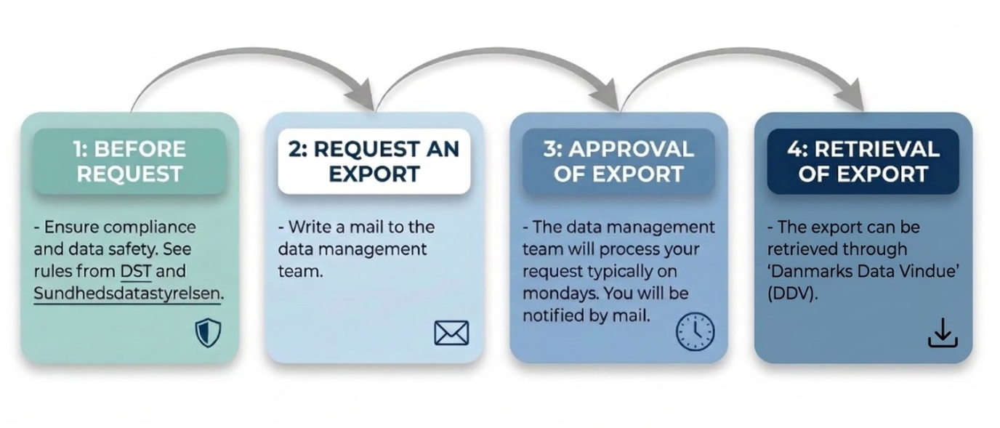

Export Guidelines for Statistics Denmark (DST) Server
================

<!-- The .md file is generated from an .Rmd file. Please edit the .Rmd; not the .md -->

------------------------------------------------------------------------

> - **Version**: 2.0
> - **Authors**: Rune Haubo B. Christensen and Clara S. Grønkjær
> - **Reviewers**: Lars N. Reiter, Andreas M. Appel, and Eva N. S.
>   Wandall
> - **Approved by**: Michael E. Benros
> - **Last edits**: 2026-10-09
> - **Responsible**: The data management team (defined below)
> - **Source document**:
>   [DST-server-export-guidelines.Rmd](server-export/DST-server-export-guidelines.Rmd)

------------------------------------------------------------------------

# Table of Contents

- [Overview](#overview)
- [Consequences for Not Conforming to the
  Rules](#consequences-for-not-conforming-to-the-rules)
- [Contact and Process Management](#contact-and-process-management)
- [Data Safety and Compliance
  Requirements](#data-safety-and-compliance-requirements)
- [Best Practices and Special Cases](#best-practices-and-special-cases)
- [Export Request Requirements](#export-request-requirements)

[Back to top](#table-of-contents)

# Overview

These guidelines describes how to export analysis results from the
Statistics Denmark (Danish: *Danmarks Statistik*, *DST*) servers. The
guidelines are meant for researchers working under Michael Eriksen
Benros’ authorization at the DST registers, and who need to send
analysis results from the servers to advance their research projects but
do not have direct export rights.

<figure>

<figcaption aria-hidden="true"><strong>Figure 1</strong>: Flowchart of
the export process.</figcaption>
</figure>

We use the following icons:

💻 **Location of program on the DST server**

⚠ **Possible methodological problems**

✔ **Possible solutions**

🕮 **Resources**

# Consequences for Not Conforming to the Rules

Recall that the consequences for not conforming to the rules are
**severe** for you and your colleagues as outlined in [the DST
requirements \[in
Danish\]](https://www.dst.dk/da/TilSalg/data-til-forskning/regler-og-datasikkerhed/sanktionsregler).
We aim to stay clear of boundary cases so we can safely export results
with minimal time spent on manual review.

Thank you for your understanding on this policy.

[Back to top](#table-of-contents)

# Contact and Process Management

## Who Handles Exports

All server exports (in Danish: “*hjemsendelser*”) are handled by the
data management team, which currently consists of:

- Clara S. Grønkjær
- Rune Haubo B. Christensen

## How to Request an Export

Send an email to the data management email and **not** personal email
addresses to ensure central saving of correspondences and continuity
regardless of team composition changes.

✉️ **Email address**:
<pck-cribp-datamanagement.region-hovedstadens-psykiatri@regionh.dk>

## Export Office Hours

Server exports are considered on a scheduled basis:

📅 **Standard schedule**: We consider exports on Mondays. Make sure your
export request email is sent to the data management team **by 8:00
Monday morning (CET)** and we will do our best that you hear from us by
Tuesday morning.

⏰ **Special requests**: We acknowledge that there may be time-critical
exports for instance during manuscript review processes. Contact us in
advance to arrange exports outside standard hours.

🌴 **Vacation periods**: We may be out of office during vacation
periods, so contact us to make arrangements if you have time-critical
exports during such periods.

## Retrieving Exports

✉️ **E-mail:** After exporting your results, we will notify you by
email.

📥 **Download**: Your results can then be downloaded from Danmarks Data
Vindue (DDV) accessible via <https://remote.dst.dk>.

[Back to top](#table-of-contents)

# Data Safety and Compliance Requirements

## Core Principles

**It is your responsibility** as the requester to:

- Ensure compliance with DST and Sundhedsdatastyrelsen requirements.
- Demonstrate that the requested export conforms to this guideline.
- Minimize manual needs for review.

## Regulatory Compliance

All exports must conform to the requirements outlined by both:

- [Statistics Denmark (Danish: *Danmarks Statistik*, *DST*) \[in
  Danish\]](https://www.dst.dk/da/TilSalg/data-til-forskning/regler-og-datasikkerhed/regler-for-hjemtagelse-af-analyseresultater)
  and in particular [this pdf \[in
  Danish\]](https://www.dst.dk/Site/Dst/SingleFiles/GetArchiveFile.aspx?fi=158751994932&fo=0&ext=forskning).
- [The Danish Health Data Authority (Danish: *Sundhedsdatastyrelsen*,
  *SDS*) \[in
  Danish\]](https://cdn.sundhedsdatastyrelsen.dk/sundhedsdatastyrelsen/Media/638695056438446333/Hjemsendelse-af-analyseresultater.pdf).

Most concerns center around the following concepts:

1.  **Microdata**
    1.  It is strictly prohibited to export microdata from the servers.
    2.  See the regulatory requirements linked above for definition and
        details.
2.  **Small cell counts**
    1.  DST specifies that any result has to represent at least 3
        individuals; Sundhedsdatastyrelsen requires at least 5
        individuals.
    2.  Because we have data from both DST and Sundhedsdatastyrelsen on
        our server access all server exports have to comply with the
        stricter requirement of **at least 5 individuals**.
    3.  Additionally we have our own policy on this subject explained
        below.
    4.  The small cell count requirement applies not only to
        individuals, but also companies, institutions and other
        entities.
3.  **Publication ready**
    1.  Both regulatory bodies require exports to represent publication
        ready results.
    2.  We interpret this to mean that all exports should aim to be
        included in a publication as a main figure or table, or
        supplementary material.

## File Organization

### Folder structure

Your files to be exported should be located in a folder in the following
location:

📁 **Path structure**

<pre>
└── E:
    └── ProjektDB
        └── PSYK
            └── Workdata
                └── 70[XXXX]
                    └── [INIT]
                        └── hjemsendelser
                            └── [YYYY-MM-DD]
</pre>

where

- `[XXXX]`: The project number (typically `8237`).
- `[INIT]`: Your unique server-wide initials.
- `[YYYY-MM-DD]`: A recent date (typically today’s date).

⚠ **Important**:

- Collect all files for an export request in a single, new folder named
  with a new date (`YYYY-MM-DD`, not in the future).
- Never reuse a path from a previous export request.
  - If today’s date has already been used, append a version number,
    e.g., `YYYY-MM-DD-v2`.
- **Always copy files manually** (Ctrl+C, Ctrl+V) into the
  `hjemsendelser/[YYYY-MM-DD]` folder.
  - Selecting files for server export should be a deliberate manual
    step, never something a program does automatically.
- Programs should write results to a different folder, e.g.,
  `Workdata/70[XXXX]/[INIT]/results`, and never to any folder under
  `Workdata/70[XXXX]/[INIT]/hjemsendelser`.

#### Example of Folder Structure

Example of folder structure with one README-file and two Excel-files.

<pre>
└── [INIT]
    └── hjemsendelser
        └── [YYYY-MM-DD]
            ├── README.txt
            ├── [filename 1].xlsx
            └── [filename 2].xlsx
</pre>

### File Format

#### README-file

- All exports should be accompanied by a `README.txt`-file located in
  the same folder as the excel-files.
- The file should as a minimum contain:
  - Details of the analysis and contents of the excel-files such as
    [column descriptions](#intuitive-variable-names).
  - Justification of false negatives derived from the [check
    functions](#validation-and-check-of-files).
  - Other information that you deem necessary.
- The README-file will not be exported.

#### Rectangular data

- Exports should contain **only** rectangular data tables in:
  - (preferably) **Excel** format (`*.xlsx` or `*.xls`).
  - (if need be) **CSV** format (`*.csv`).

**Group tables**:

- To make reviewing of export requests easier, we ask that files are
  divided into sheets or excel-files depending on the scope of the
  request:
  - **1-5 tables**: The tables can either be in separate Excel-files or
    in the same Excel-file.
  - **\>5 tables**: The tables should be grouped into a handful of
    files, so that the number of sheets is more manageable.

#### Intuitive variable names

**Variable names** should be meaningful and intuitive – especially
variables that are key to our review.

- Columns referring to **number of individuals** should begin with `N_`.
  - For example, use `N_individuals` or `N_persons` rather than `n`,
    `N`, `Count`, `Cases` etc.
- If your analysis is event-based such as most survival-type analyses
  you should also have a column named `N_events` and potentially
  `N_individuals_with_events` if individuals can have more than one
  event.
- Describe the meaning of variables whose meaning is not obvious in the
  README-file.
- Ensure the variable descriptions do not contain microdata or otherwise
  violate export requirements.

#### Example of a table ready for export

    #>   age_group N_individuals N_events hazard_ratio confidence_interval
    #> 1    [0,18)          1000      100         1.00         (reference)
    #> 2   [18,40)          2000      200         1.03        (1.01, 1.05)
    #> 3   [40,60)          1500      150         1.04        (0.99, 1.09)
    #> 4  [60,Inf)          2200      220         0.98        (0.90, 1.06)

**Table 1**: An example of a table ready for export (fake data).

#### Code files

Exporting code files, such as `.R`-files, is occasionaly needed. This
requires substantial manual review and **needs to be agreed with the
data management team in advance**.

## Requirements for the Number of Individuals

We ask requesters to **avoid boundary cases**, enabling faster review
and turnaround for all. See the section on [number of
individuals](#best-practices-and-special-cases).

**Requirements**

1.  All results **must** be based on **at least 5 individuals**. An
    estimate cannot be exported if it is based on a group of fewer than
    5 individuals, or on any group with fewer than 5 individuals with
    the event of interest.
    1.  **Rates** (events per time unit) must be based on at least 5
        events per rate estimate. Include the number of events as a
        separate column (`N_events` or `N_individuals_with_events`) so
        we can check this.
    2.  **Percentages, risks and other relative measures** involve
        individuals in both the numerator and the denominator. Include
        the numerator (e.g., `N_individuals_with_event`) as a separate
        column, and make it clear that the denominator also contains
        enough individuals.
2.  For **model-based results** (e.g., predictions, hazard ratios),
    state how many individuals and events (or similar) went into each
    estimate, so we can verify the rule above.

### Rule of Totals

The rule of totals, described in the DST requirements, implies that it
should not be possible to reverse engineer small cell counts.

⚠ **Possible Problems**

- You cannot simply hide a cell with too few individuals behind `<5` (or
  equivalently remove the corresponding row in the data table) because
  it is possible to figure out how many are in that cell by extraction
  from the total number.
- Reverse engineering small counts should also not be possible across
  multiple tables that may be exported throughout the course of your
  project.

<!-- -->

    #>         age_group N_individuals N_events
    #> 1 All individuals          6700      522
    #> 2          [0,18)          1000      100
    #> 3         [18,40)          2000      200
    #> 4         [40,60)          1500       <5
    #> 5        [60,Inf)          2200      220

**Table 2**: An example of a table **not ready for export** since small
cell counts (`<5`) can be reversed engineered to reveal
`522-100-200-220=2` events.

✔ **Possible Solutions**

- Instead you have to collapse categories.

<!-- -->

    #>         age_group N_individuals N_events
    #> 1 All individuals          6700      522
    #> 2          [0,18)          1000      100
    #> 3         [18,40)          2000      200
    #> 4        [40,Inf)          3700      222

**Table 3**: An example of a table **ready for export** since small cell
counts (`<5`) have been collapsed with other groups.

## Validation and Check of Files

✅ **Before submitting your export request**, validate your files:

1.  **Manually review all files**: Open all files and scrutinize them
    for potential violations.
2.  **Run the R check functions** on your export tables.
    1.  Location of check functions:
        `Workdata/708237/06_data_management/001_functions/check_functions.R`.
    2.  We apply the same check functions during review. Unexplained
        suspicious results will require extended manual review, may lead
        to requests for modifications and all in all delay the export.
3.  **Ensure no suspicious counts** are flagged, and if they are, either
    1.  **Eliminate false negatives** (e.g., numeric exposure levels)
        before submission, or
    2.  **Explain any false negatives that you were unable to remove**
        in a `README.txt` file in your export request folder.

💻 **Location of program on the DST server**: The `check_functions.R`
program is located on the following path:

<pre>
└── Workdata
    └── 708237
        └── 06_data_management
            └── 001_functions
                └── check_functions.R
</pre>

**Example: Running R check functions**

``` r
# Load functions
source("../../06_data_management/001_functions/functions.R")
source("../../06_data_management/001_functions/check_functions.R")

# Read tables
path <- <path_to_folder>
tabs <- read_all_tables(path)

# Check potential violations
res <- list_check_all(tabs)
res[n > 0]
```

⚠ **Common False Negatives**

1.  Categorical or binary variables coded with numeric levels (`0`, `1`,
    etc.). Although thry are not microdata, they will trigger flags from
    the check-functions.
2.  Formating numbers with thousand separator in large numbers (e.g.,
    1,234). Although the number is much larger than 5, the number is
    flagged.

✔ **Possible Solutions**

1.  Rename levels to letters (`a`, `b`) or descriptive names (`level0`,
    `level1`).
2.  Do not use thousand separators.

[Back to top](#table-of-contents)

# Best Practices and Special Cases

## Number of Individuals

Because population registers are administrative data, their reliability
drops sharply for small samples, so we prioritise **large-scale
analyses**, and although the official requirements is **5 individuals**,
one should aim for all results to be based on at least **10
individuals**.

## Rounding Numbers

**DST micro data warnings** is triggered by numerical values with 8-14
decimal places as this might identify a person (CPR) or company (CVR).

1.  Numbers intended for publication or presentation should be rounded
    to **2-3 (significant) digits**.
2.  Numbers intended for further processing in figures or similar should
    be formatted with up to **7 digits**. This preserves sufficient
    precision while avoiding the warning trigger.

## ‘Missing’-Categories in Baseline Tables

By *baseline table* we mean the typical *Table 1* that is used to
describe the characteristics of a cohort. It may not actually refer to
any meaningful definition of a *baseline*.

⚠ **Possible problems**

1.  **Small “*Unknown*” categories**
    1.  Baseline tables often have a few missing values, giving a small
        “*Unknown*” or “*NA*” category (e.g., unknown income).
    2.  If these cells contain fewer than 5 individuals they cannot be
        exported – even though the category represent missing values
    3.  For example, recent immigrants not yet in the income register at
        the cutoff date.

✔ **Possible Solutions**

1.  **Small “*Unknown*” categories:**
    1.  **Single imputation**: Merge individuals with unknown values
        into another group, typically the majority group, or another
        more obvious group.
        1.  State this in your statistical methods section, e.g.,
            “*Individuals with missing values on any attribute were
            single-imputed to the majority group.*”
    2.  **Complete case analysis**: Individuals with *NA* values are
        excluded from the analysis. This is generally not recommended.
    3.  **Multiple imputation** is rarely worth the effort when few
        values are missing among millions of individuals.

## Exporting Plots & Graphics

Avoid exporting plots and other graphics. Instead:

1.  **Export the summary data** needed to produce the plot.
2.  **Create the graphics outside the DST server** (e.g., on your local
    computer).

**The benefits**:

- Easy to verify that exported data comply with requirements.
- Transparent about what data leave the server.
- Easy to update graphical layout without re-exporting.

## Summary Statistics and Quantiles

⚠ **Possible Problems**

Some summary statistics equal the value of a single individual:

1.  **Quantiles (median, Q1, Q3, IQR)**
    1.  These statistics usually equal the value of a single individual.
    2.  In some cases this is harmless, e.g., a median age of `32` (no
        decimals) in a large population, since there are probably many
        32-year-olds.
    3.  However, each such case requires manual review, so **we ask that
        quantiles are avoided if at all possible**.
2.  **Minimum, maximum and range**
    1.  These identify extreme individuals, and we strongly discourage
        them.

✔ **Possible Solutions**

Reasonable alternatives almost always exist:

1.  **Mean (SD)**
    1.  Use the mean and standard deviation (SD) instead of median (IQR)
        in baseline tables and similar.
2.  **Geometric mean and SD**
    1.  For right-skewed data, the [geometric mean and
        SD](https://en.wikipedia.org/wiki/Geometric_mean) are
        appropriate.
3.  **Skewness and kurtosis**
    1.  Rarely used, but they add detail on the shape of the
        distribution ([skewness and
        kurtosis](https://en.wikipedia.org/wiki/Moment_(mathematics))).
    2.  In **R**, the functions `skewness()`, `kurtosis()` and
        `moment()` can be used from the packages
        [e1071](https://cran.r-project.org/package=e1071) and
        [moments](https://cran.r-project.org/package=moments).
4.  **Categorized variable**
    1.  Report the distribution of a categorized version of the
        variable.
    2.  This is often the best addition to mean (SD) and gives a fairly
        fine-grained description of the distribution.
    3.  In **R**, combine the functions `cut()` and `quantile()` as
        detailed below:

**Example: Create a categorized version of a numerical variable**

``` r
# 0: Make example numerical variable `n_var`
set.seed(1234) # For reproducibility 
n_var = rnorm(1e3, 100, 5)

# 1. Get cut-points for categories
cuts <- round(quantile(n_var, probs = seq(.2, .8, by=.2)))

# 2. Make readable labels for the categories
labs <- c(
  paste0("<", cuts[1]),
  paste(cuts[-length(cuts)], cuts[-1], sep = " * "),
  paste0(">", cuts[length(cuts)]))

# 3. Create factor for categorized version of `n_var`
f_var <- cut(
  n_var, 
  breaks = c(-Inf, cuts, Inf),
  include.lowest = TRUE,
  labels = labs)

# 4. Count observations per category
as.data.frame(table(f_var))
#>       f_var Freq
#> 1       <96  217
#> 2   96 * 99  216
#> 3  99 * 101  171
#> 4 101 * 104  205
#> 5      >104  191
```

## Curves for Step Functions

⚠ **Possible Problems**

1.  Steps in curves based on **step functions** may represent a single
    individual. This applies to:
    1.  **Non-parametric curves**, e.g., Kaplan-Meier survival curves.
    2.  **Calibration curves** from prediction models, e.g., ROC curves.

✔ **Possible Solutions**

1.  **Smoothing of curves**
    1.  Smooth the data behind the curves before export.
    2.  In **R**, with `smooth.spline()`.
    3.  Export the smoothed table used to plot the curve, not the curve
        itself.

[Back to top](#table-of-contents)

# Export Request Requirements

## Email Requirements

Use the template below as a checklist:

- Fill in the information in angle brackets (e.g., `<YYYY-MM-DD>`).
- Check off the boxes (`[ ]->[x]`).

<!-- -->

    ---
    Send to: pck-cribp-datamanagement.region-hovedstadens-psykiatri@regionh.dk
    Email title: DST server export request
    ---

    Dear data management team,

    I would like to make a DST server export request for:
      * The project on <details about the project>.
      * Deadline: <YYYY-MM-DD>.

    The files are located in this folder on the DST server:
      * E:/Workdata/70<XXXX>/<INIT>/hjemsendelser/<YYYY-MM-DD>

    Contents of the folder:
      * [ ] A README.txt file describing the analysis and the contents of the Excel files, including column descriptions.
      * [ ] <NUMBER> Excel files with analysis results.
      * [ ] All files are in approved formats (`.xlsx`, `.xls`).
      * [ ] I have checked that there are no hidden files in the folder.

    Statement of complicane with requirements: 
      * [ ] I have reviewed all files for microdata, small cell counts and other potential violations. 
      * [ ] I have manually opened and reviewed all files. 
      * [ ] I guarantee that all files comply with the requirements of DST and Sundhedsdatastyrelsen and the DST-server-export-guidelines document.

    Column names:
      * [ ] All columns that refer to a number of individuals start with `N_`.
      * [ ] For rates and percentages, I have reported the number of events or individuals in each row.

    R check functions:
      * [ ] I have run the R check functions on all tables, and they returned no false negatives.
      * [ ] I have run the R check functions on all tables, and they returned false negatives, which I have explained in the README.txt file.

    Minimal data requirements:
      * [ ] All results are based on ≥5 individuals and ≥5 events.
      * [ ] All numbers are rounded to at most 7 digits.
      * [ ] There are no problematic summary statistics such as quantiles, minima or maxima.

    Best Regards
    <Donald Duck>

[Back to top](#table-of-contents)
